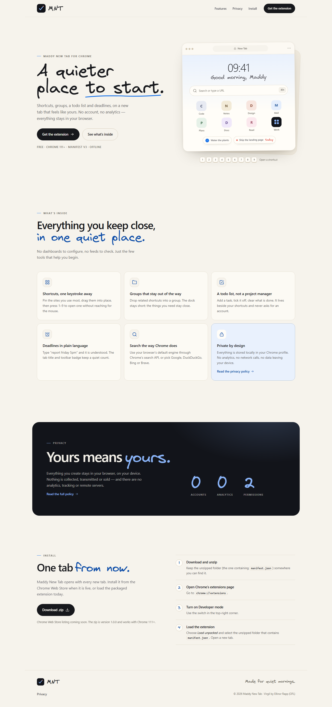

# Maddy New Tab — website

The landing page for the Maddy New Tab Chrome extension. Minimal, calm and
local-first in tone, built with React and Vite, with no UI framework or runtime
dependencies beyond React.



## Design notes

- **Lockup.** The mark is an ink tile containing a hand-drawn check and a small
  red dot — the check for todos, the dot for a deadline, the tile for a shortcut.
  It matches the extension's toolbar icon, so the product and the site read as
  one family. The MNT wordmark is set in **Virgil**, the same handwriting font
  used inside the extension.
- **Palette.** Warm paper (`#f6f3ec`) and ink (`#17181c`) with the app's blue
  accent (`#1a73e8` light / `#8ab4f8` dark) and a single red signal colour.
  Dark mode uses the same accent logic as the extension.
- **Type.** Virgil for display and the wordmark; the system sans stack for body
  copy, so there is no second webfont to download.
- **Product preview.** The hero mockup is built in HTML/CSS rather than an image,
  so it stays crisp and updates with the design tokens.
- **No clutter.** No analytics, no cookie banner, no external embeds, no icon
  libraries. The only third-party asset is the bundled Virgil font (OFL).

## Run locally

Requires Node.js 20.19+ (Node 22 or 24 recommended).

```sh
cd maddy-new-tab
npm install
npm run dev
```

Vite prints a local URL (usually `http://localhost:5173`). The page and the
static privacy page are both served from there.

## Build

```sh
npm run build
npm run preview
```

The production site is written to `maddy-new-tab/dist`. It is fully static:
`index.html`, hashed CSS/JS assets, the font, the icons, the privacy page and
the downloadable extension zip.

## Deploy to Vercel

1. Push this repository to GitHub.
2. In Vercel, choose **Add New → Project** and import the repository.
3. Set **Root Directory** to `maddy-new-tab`.
4. Vercel detects **Vite**; confirm:
   - Build Command: `npm run build`
   - Output Directory: `dist`
   - Install Command: `npm install` (or `npm ci`)
5. Click **Deploy**. No environment variables are needed.

From the CLI (run inside `maddy-new-tab`):

```sh
npm i -g vercel
vercel          # preview deployment
vercel --prod   # production deployment
```

### Custom domain

Add the domain in Vercel → **Settings → Domains**. If you use the site as the
privacy-policy host for the Chrome Web Store, the URL will be
`https://<your-domain>/privacy-policy.html` (or the Vercel preview URL).

## Before publishing

Edit [`src/config.js`](./src/config.js):

```js
export const site = {
  name: 'Maddy New Tab',
  shortName: 'MNT',
  version: '1.0.0',
  storeUrl: '',   // Chrome Web Store listing URL
  githubUrl: '',  // repository URL
  zipUrl: '/downloads/maddy-new-tab-1.0.0.zip',
}
```

- With `storeUrl` empty, the main CTA scrolls to the install steps and the
  **Download .zip** button is the primary action. Fill it in once the listing is
  live to show **Add to Chrome** buttons and a store link in the footer.
- Fill `githubUrl` to show the **Source** / **GitHub** links in the header,
  install section and footer.
- Update the `index.html` metadata (`<title>`, description, Open Graph copy) if
  you change the positioning.

## Updating the downloadable extension

The site serves the store-ready package at
`public/downloads/maddy-new-tab-1.0.0.zip`.

1. Bump `version` in `extension/manifest.json` and rebuild the zip (see the
   root README).
2. Copy the new zip into `maddy-new-tab/public/downloads/`.
3. Update `site.version` and `site.zipUrl` in `src/config.js` if the filename
   changed.
4. Update the install note in `src/App.jsx` if it mentions the version.

## Privacy page

`public/privacy-policy.html` is a standalone, styled copy of the extension's
privacy policy. It has no scripts and makes no requests. Use its public URL in
the Chrome Web Store **Privacy** tab.

## File structure

```
maddy-new-tab/
  index.html               Meta, favicon links, root element
  public/
    favicon.svg             Tile mark (SVG)
    icon16.png … icon128.png  PNG icon set / apple-touch icon
    privacy-policy.html     Static policy page
    downloads/              Store-ready extension zip
    fonts/Virgil.woff2      Bundled handwriting font (OFL)
    fonts/OFL.txt
  src/
    App.jsx                 Page sections + mockup + logo mark
    App.css                 Layout and components
    index.css               Tokens, @font-face, base styles
    config.js               Store, GitHub and zip URLs
    main.jsx
  preview-light.png
  preview-dark.png
```

## Checks

```sh
npm run lint    # oxlint, zero warnings
npm run build   # production build
```

A dev-only screenshot/QA helper lives at
[`../tools/site-shot.mjs`](../tools/site-shot.mjs). It uses a local Chrome
install to capture full-page light/dark screenshots and report console errors,
horizontal overflow and font loading:

```sh
node tools/site-shot.mjs http://127.0.0.1:5173/ preview.png light 1440 1000
```

The helper is not part of the website bundle.

## License

The site code is © its author; add a `LICENSE` file if you want others to reuse
it. The bundled Virgil font is licensed under the SIL Open Font License 1.1 —
see `public/fonts/OFL.txt`.
